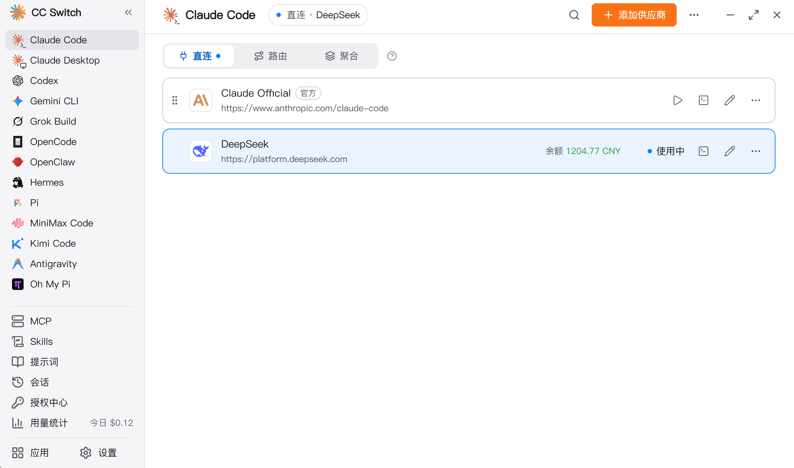
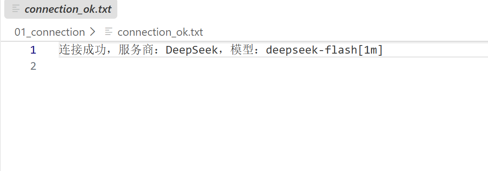
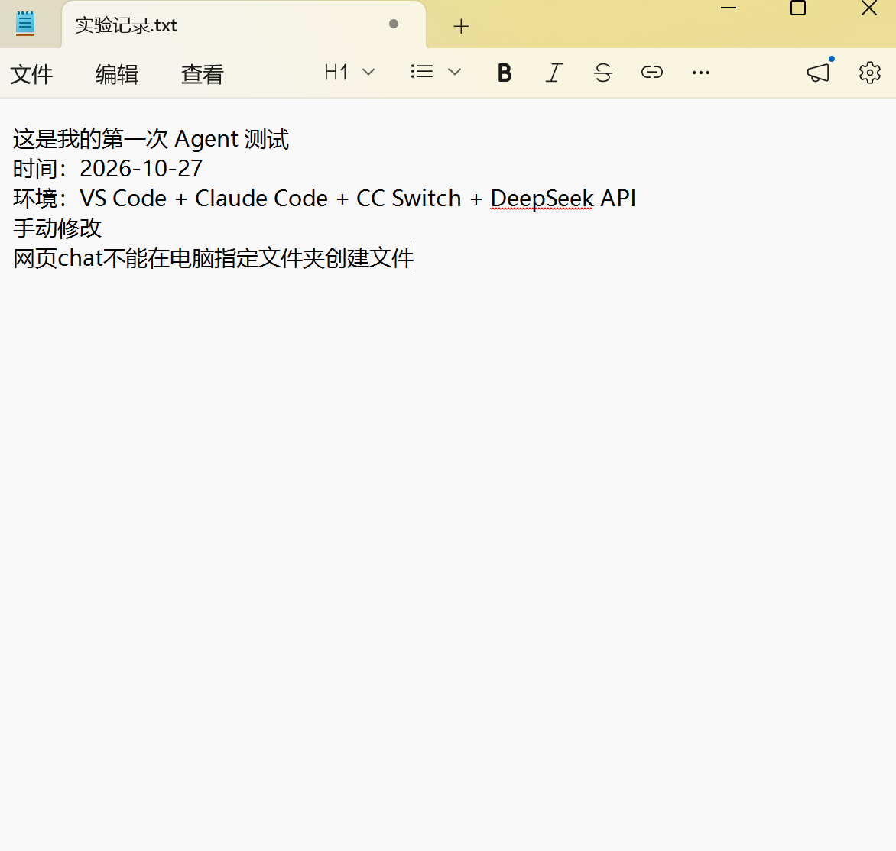

# 智能体实践实验一：实验记录

- 学号：2024187025
- 姓名：牛晨杰
- 日期：2026-10-27
- 课程：智能体实践
- 提交目录：`2024187025-牛晨杰-智能体实践实验一`

## 一、实验目标与完成情况

| 实验要求 | 完成情况 | 证据 |
|---|---|---|
| 配置 Agent 客户端 + DeepSeek API | 已完成，实际请求 HTTP 200 | `outputs/01_connection/config_record.md`、`api_probe.json` |
| 读取本地资料、创建并回读 txt | 已完成，含外部修改后重读 | `outputs/02_file_ops/file_ops_log.md`、`实验记录.txt` |
| 自建含 references 和 scripts 的 Skill | 完成 2 个 | `.claude/skills/de-analysis/`、`.claude/skills/medical-dialogue/` |
| 运行 Skill 并核验结果 | 两个 Skill 的 `checks.py` 均通过 | `outputs/03_skill_de/checks.json`、`outputs/04_skill_dialogue/checks.json` |
| 普通提示词与 Skill 对照 | 已完成，含异常场景 | `outputs/05_compare/compare.md` |
| 安装并改造现有 Skill | `skill-creator`，Apache 2.0 | `outputs/06_existing_skill/modification_record.md` |
| 发布到 GitHub | 本地仓库已提交，远端待推送 | 见本记录第八节 |

## 二、环境配置与 DeepSeek 连接

### 2.1 工具版本

| 工具 | 版本 |
|---|---|
| VS Code | 1.133.0（x64） |
| Claude Code 扩展 | `anthropic.claude-code@2.1.311` |
| CC Switch | 4.0.21 |
| Python | 3.14.7（虚拟环境 `.venv`） |
| R | 未安装（脚本改用 Python） |
| Git | 2.56.0.windows.3 |
| pandas / numpy / scipy | 3.1.0 / 2.5.4 / 1.18.1 |

实验说明要求 Python 3.10、R 4.0 以上。本机实际为 Python 3.14.7，无 R；两个 Skill
的脚本只依赖 Python 科学计算库，Python 3.10+ 可运行，差异如实记录。

### 2.2 配置内容

用户级配置文件：`C:\Users\21336\.claude\settings.json`（不在仓库内）。

| 配置项 | 值 |
|---|---|
| `ANTHROPIC_BASE_URL` | `https://api.deepseek.com/anthropic` |
| `ANTHROPIC_MODEL` | `deepseek-flash[1M]` |
| 默认 Haiku/Sonnet/Opus 模型 | 均为 `deepseek-flash[1M]` |
| `ANTHROPIC_AUTH_TOKEN` | 已配置，本记录不保存明文 |
| CC Switch `live-state.json` | `"claude": {"mode": "direct"}` |

CC Switch 中新增 DeepSeek 服务商并启用，Claude Code 使用 direct 模式，没有经本地代理。





### 2.3 实际请求核验

为避免“只看模型自述”，用 `outputs/01_connection/verify_endpoint.py` 按当前配置向
`https://api.deepseek.com/anthropic/v1/messages` 发送了一次最小请求，结果为：

```text
base_url           https://api.deepseek.com/anthropic
model_configured   deepseek-flash[1M]
http_status        200
response_model     deepseek-flash[1M]
server_header      openresty
auth_token         REDACTED
```

结论：请求实际发往 DeepSeek 的兼容端点，HTTP 200，响应模型与配置一致。密钥只存在于
用户级配置中，未写入任何提交文件。

### 2.4 连接测试文件的创建与回读

按实验步骤二.1(4)，用写入工具创建 `connection_ok.txt` 并立即用读取工具回读：

- 写入内容：`连接成功，服务商：DeepSeek，模型：deepseek-flash[1m]`
- 回读结果与写入完全一致，文件 66 字节，UTF-8 编码。
- 项目根目录保留一份，`outputs/01_connection/connection_ok.txt` 为运行产物副本。

说明：该文件内容是按实验要求写入的测试字符串，**不能单独作为“连的是 DeepSeek”的证据**；
真正的证据是 2.3 的实际请求响应（HTTP 200、`response_model` 与配置一致），以及 CC Switch
显示的启用状态。

## 三、Agent 的文件操作与环境信息获取

### 3.1 使用的提示词

> 在当前文件夹创建“实验记录.txt”，内容自拟，例如：“这是我的第一次 Agent 测试”。完成后读取文件，展示其中的内容。

### 3.2 执行与结果

1. Agent 调用写入工具创建 `实验记录.txt`，返回路径与预期一致。
2. Agent 调用读取工具，读到 3 行内容，与写入一致。
3. 为验证“重新读取”，使用独立的 PowerShell 进程（Agent 工具之外）改写文件，
   新增一行“手动修改：这一行是在 Agent 之外写入的……”。
4. Agent 再次读取，读到 4 行，包含新增内容，说明读取的是磁盘当前状态，不是会话缓存。

工具调用观察：写入工具返回成功状态和实际路径；读取工具返回带行号的内容；外部修改后
文件大小变为 237 字节、修改时间更新；再次读取立即反映新内容。



### 3.3 与网页 Chat 的对比

网页 Chat 的普通对话不能直接访问本机文件系统。它可以生成一段文字，但不能在指定文件夹
创建、修改或读取文件；除非接入了文件工具（Claude Code、文件上传/下载、MCP 文件工具等）。

- “回复一段文字”只改变对话上下文，结果需要用户自己复制保存。
- “调用工具操作本地文件”会产生真实文件系统副作用，且结果可被再次读取核验。

本实验的 Agent 属于后者。网页 Chat 的具体提示语随产品版本不同，建议亲自补测并截图，
记录其实际回复。截图清单见第九节。

## 四、自建 Skill 一：de-analysis

### 4.1 任务与目录

任务：读取基因表达矩阵和样本分组，完成两组比较，输出差异基因表、火山图和说明。

```text
de-analysis/
├── SKILL.md
├── references/
│   ├── index.md       # 导航：何时读 overview/rules
│   ├── overview.md    # counts/normalized、Welch、BH、与 DESeq2 的差异
│   └── rules.md       # 列名、样本对应、数据类型、检验、阈值、异常
├── scripts/
│   ├── run.py         # 入口
│   ├── data_io.py     # 读取、校验、类型判断、log 转换
│   ├── stats_utils.py # fold change、Welch/Mann-Whitney、BH
│   ├── checks.py      # 独立复算与阈值一致性核验
│   └── make_demo_data.py
└── examples/
    ├── expression_demo.csv
    ├── groups_demo.csv
    ├── truth_demo.csv
    └── README.md
```

### 4.2 数据说明

教师提供的真实表达矩阵未出现在工作区，因此使用 `make_demo_data.py` 生成模拟数据：
300 个基因 × 6 个样本（control 3、treat 3），负二项分布 counts，40 个真差异基因，
log2FC 在 1.6–3.0 之间，另有 5 个全 0 基因用于测试零方差处理。随机种子
`20241027`，可重复生成。`truth_demo.csv` 只用于自检，不参与分析。

这是模拟数据，不是教师数据；换成真实数据时保持 `gene_id + 样本列` 和
`sample,group` 的列结构即可。

### 4.3 方法与筛选标准（详见 references/rules.md）

- 数据类型自动判断：非负整数且最大值 > 20 → counts；否则 normalized。
- counts：按列 CPM 归一化，再取 log2(CPM + 1)。
- 检验：双侧 Welch t 检验，不假设方差齐；可选 Mann-Whitney。
- 多重校正：Benjamini-Hochberg FDR。
- 比较方向：log2FC = mean(treat) − mean(control)，正值表示 treat 更高。
- 阈值：|log2FC| ≥ 1 且 padj < 0.05。
- 零方差基因保留并标记；NaN P 值按 1 处理并计数。

### 4.4 运行命令与结果

```powershell
python .\.claude\skills\de-analysis\scripts\run.py `
  --expression .\.claude\skills\de-analysis\examples\expression_demo.csv `
  --groups .\.claude\skills\de-analysis\examples\groups_demo.csv `
  --group-a control --group-b treat --output-dir .\outputs\03_skill_de
```

结果：300 个基因，显著 20 个（上调 5、下调 15）；P 值范围 4.31e-05 ~ 1，
padj 范围 0.0129 ~ 1；5 个零方差基因。

输出文件：`de_results.csv`、`de_significant.csv`、`volcano.png`、`summary.md`、
`analysis_config.json`、`validation.json`。

### 4.5 结果核验

`checks.py` 14 项全部通过：

- 基因数量与 ID 集合与输入一致；
- 关键数值无缺失/无穷，P 值与 padj 在 [0,1]；
- 复算 log2FC、P 值、padj，最大偏差均为 0.00e+00；
- 显著标记与阈值一致，显著表与结果表一致；
- 说明包含比较方向，火山图非空；
- 与真值比较：精确率 1.000，召回率 0.500。

召回率只有 0.5 是方法在小样本下的实际表现，不是脚本错误；结果说明中已注明
Welch + log2 CPM 不等于 DESeq2/edgeR。

### 4.6 Skill 识别测试（新会话）

在项目根目录用 Claude Code CLI 启动新会话，要求列出可用 Skill：

```powershell
claude -p "列出当前会话可用的 skill 名称，只列名称，每行一个，不要调用任何工具。"
```

输出包含：

```text
de-analysis
medical-dialogue
skill-creator
...
```

说明两个自建 Skill 和改造后的 `skill-creator` 都能被新会话识别。完整输出见
`outputs/skill_discovery.log`。
当前正在运行的会话是在创建 Skill 之前启动的，技能注册表不会热刷新，直接调用
`medical-dialogue` 会报 `Unknown skill`；新会话没有这个问题。这是会话缓存现象，
不是 Skill 目录或 frontmatter 的问题（结构校验 20/20 通过）。

同一次测试还出现 `[claude-code:unrecognized_model]`，仅用于生成会话标题；
主对话、工具调用和 Skill 识别均正常，属于模型别名兼容性提示。

### 4.7 遇到的问题与处理

第一次运行（30 个差异基因、负二项 dispersion n=8）得到 0 个显著基因。诊断发现
log2FC 估计准确（真值平均 |log2FC| 1.878，估计 1.910），但 3v3 样本下 P 值最小
0.000466，BH 校正后最小 padj 0.083，确实达不到 0.05。

处理：这是演示数据功效不足，不是分析脚本错误。调整的是模拟数据生成参数（差异基因
40 个、效应量 1.6–3.0、dispersion n=25），没有修改检验方法或阈值，也没有筛选数据。
调整后 20 个显著基因，真值精确率 1.0、召回率 0.5，并在 `examples/README.md` 中
注明“参数刻意设置为小样本下可检出，真实数据不会这样理想”。

## 五、自建 Skill 二：medical-dialogue

### 5.1 任务与目录

任务：把医生-患者对话原文整理成结构化问答记录，逐字保留，不补充原文没有的信息。

```text
medical-dialogue/
├── SKILL.md
├── references/
│   ├── index.md
│   ├── overview.md    # 为什么逐字整理而不是概括
│   └── rules.md       # 输入格式、配对、逐字、异常、核验
├── scripts/
│   ├── run.py         # 入口：解析、配对、输出 md/json
│   ├── parse.py       # 解析、合并、配对、归一化
│   └── checks.py      # 逐字追溯与覆盖核验
└── examples/
    └── sample_dialogue.txt
```

### 5.2 规则要点

- 支持 `[时间] 说话人：内容`，时间戳可省略，中文/英文冒号均可。
- 医生别名：医生、医师、doctor、dr；患者别名：患者、病人、patient；护士、家属等
  归入“其他角色”，不强行配对。
- 连续同一说话人合并；患者后紧跟医生 → 问答对；患者无回应 → 未配对；
  医生无患者提问 → 医生单方面说明。
- 只删除时间戳和说话人标签，不改写、不概括、不补充诊断/药物/剂量。
- 格式错误行、空内容行单独记录，不静默丢弃。

### 5.3 运行命令与结果

```powershell
python .\.claude\skills\medical-dialogue\scripts\run.py `
  --input .\.claude\skills\medical-dialogue\examples\sample_dialogue.txt `
  --output-dir .\outputs\04_skill_dialogue --title "门诊高血压复诊对话（示例）"
```

结果：20 行原文 → 17 条有效发言（合并后）→ 7 个问答对；未配对患者发言 1 条、
医生单方面说明 1 条、其他角色 1 条、格式错误 1 行、空内容 1 行。

输出：`qa.md`（可读问答记录，带原文行号）、`qa.json`（结构化数据）。

### 5.4 结果核验

`checks.py` 7 项全部通过：

- 必需文件齐全，统计数字与实际一致；
- 每个问答对均为患者问、医生答；
- 每个输出文本去空白后都是原文子串，且与对应原文片段完全一致；
- 18 个原文片段全部被且仅被覆盖一次；
- `qa.md` 统计与 `qa.json` 一致，并声明“未补充、未改写、未推断”。

### 5.5 异常场景

示例数据故意包含：无冒号的广播行、护士发言、连续两条患者发言、空内容的“医生：”、
最后一条患者发言无医生回应。运行结果全部显式列出，没有丢弃，也没有把护士的话
误配成患者提问。

## 六、安装并改造现有 Skill：skill-creator

### 6.1 来源与许可

- 仓库：https://github.com/anthropics/skills
- 路径：`skills/skill-creator`
- 提交：`dbd4588f9e1033efb41dad4bef2f7947c8993d44`（2026-10-09）
- 许可：Apache License 2.0，原始 `LICENSE.txt` 保留
- 安装位置：`.claude/skills/skill-creator/`

没有选择官方 `pdf`、`docx` 等 Skill，因为它们的 LICENSE 明确禁止制作衍生作品；
`skill-creator` 的 Apache 2.0 允许修改与再分发。

### 6.2 改造前的真实问题

官方 `quick_validate.py` 在 Windows 上调用 `Path.read_text()`，默认 GBK 编码；
读取 UTF-8 中文 SKILL.md 时直接崩溃：

```text
UnicodeDecodeError: 'gbk' codec can't decode byte 0xae in position 61:
illegal multibyte sequence
```

此外，官方校验只检查 frontmatter。用一个故意有缺陷的样例测试，它仍返回
`Skill is valid!`，而该样例缺少 references、examples、checks.py，还写入了假密钥
和本机绝对路径。

### 6.3 具体改动

| 文件 | 改动 |
|---|---|
| `scripts/quick_validate.py` | 改为 `read_text(encoding="utf-8")`，修复中文崩溃 |
| `scripts/validate_coursework_skill.py` | 新增 20 项课程校验 |
| `references/cn-coursework-checklist.md` | 新增课程检查清单 |
| `SKILL.md` | 新增“课程作业增强”一节 |
| `NOTICE.md` | 新增来源、提交号、许可、修改记录 |

新增校验覆盖：frontmatter、名称与目录一致、导航、深层参考、入口脚本、`checks.py`、
示例输入、输入/输出/流程/核验说明、疑似密钥、本机绝对路径、运行结果 `checks.json`。

### 6.4 改造前后输出

| 对象 | 改造前 | 改造后 |
|---|---|---|
| `de-analysis` | GBK 崩溃 | `Skill is valid!`；课程校验 20/20 |
| `medical-dialogue` | GBK 崩溃 | `Skill is valid!`；课程校验 20/20 |
| 缺陷样例 | 官方结构校验仍判 valid | 课程校验 6 通过、11 失败 |

11 项失败包括：名称与目录不一致、缺 `references/index.md`、缺深层参考、缺
`checks.py`、缺示例、缺输入输出/流程/核验说明、命中假密钥、命中绝对路径。

完整日志：`before_quick_validate.log`、`after_quick_validate.log`、
`broken_validation.log`、`structure_only_vs_coursework.log`。

## 七、普通提示词与 Skill 对照

详见 `outputs/05_compare/compare.md`。摘要：

| 维度 | 普通简短提示词 | 调用 Skill |
|---|---|---|
| 完整性 | 1 个结果文件，无参数/图/核验 | 7 个输出文件，含图、配置、校验 |
| 来源 | 无方法、版本、行号 | 记录数据模式、方法、阈值、版本；对话保留行号 |
| 数值 | 原始 counts 均值差，无 P 值/FDR | CPM+log2、Welch、BH；复算偏差 0 |
| 异常处理 | 样本不匹配时 `KeyError` 调用栈 | 退出码 2，列出缺失样本 |
| 结果 | Top20 中 12 个未达 padj<0.05 | 20 个显著基因，精确率 1.0 |

对话整理两轮的 7 个主要问答语义一致，普通轮没有编造诊疗信息；但遗漏了护士、广播、
未配对患者和空内容行，且无行号、无法自动核验逐字来源。因此准确结论是“主要问答正确，
完整性和可追溯性不足”，不是“普通轮全错”。

## 八、Git 与 GitHub 发布

- 本地仓库：`2024187025-牛晨杰-智能体实践实验一`
- 首次提交哈希：`c86f7ff8a6e45a2bd570a2129ee1abf980935313`
- 远端仓库：待创建并推送（推送前已确认待上传文件清单，不含密钥和 `.venv`）
- `.gitignore` 排除：`.venv/`、`__pycache__/`、`.claude/settings.json`、
  `.claude/settings.local.json`、`.env`、`*.zip`

## 九、提交清单与待补材料

### 9.1 已生成

- `skills/` 对应 `.claude/skills/`：两个自建 Skill + 改造后的 skill-creator；
- `outputs/`：配置记录、文件操作、两个 Skill 运行输出、对照、现有 Skill 改造；
- `实验记录.docx`（由本文件生成）；
- 本地 Git 仓库与 ZIP 包。

### 9.2 截图与待补材料

已收到的截图放在 `docs/screenshots/`，并已插入本文档第二、三节：

- [x] CC Switch 的 DeepSeek 服务商配置页，画面中未出现密钥
      （`01_ccswitch_deepseek.png`；该页是服务商列表，Base URL 与模型名见 2.2 表格，
      需要页面级证据可补拍编辑页）
- [x] 连接测试文件 `connection_ok.txt` 的实际内容（`01b_connection_ok_file.png`）
- [x] `实验记录.txt` 手动修改后的实际内容（`05a_file_modified_content.png`）
- [ ] VS Code 中 Claude Code 的成功响应（同一张图里带上模型状态栏）
- [ ] 文件资源管理器中 `connection_ok.txt`、`实验记录.txt` 存在
- [ ] `实验记录.txt` 第一次读取结果（可与手动修改截图合并为前后对比）
- [ ] 网页 Chat 对同一提示词的回复（证明不能直接写本地文件）
- [ ] 两个 Skill 的 `checks.py` 终端输出
- [ ] GitHub 仓库页面（推送后）

### 9.3 同伴复现

- 待补充：同伴姓名、复现命令、遇到的问题。

## 十、问题与修正记录

| 问题 | 现象 | 修正 | 验证 |
|---|---|---|---|
| 官方 quick_validate 中文崩溃 | `UnicodeDecodeError: 'gbk' ...` | 显式 `encoding="utf-8"` | 两个 Skill 均返回 `Skill is valid!` |
| 模拟数据 0 个显著基因 | padj 最小 0.083 | 调整模拟参数（效应量/离散度/差异基因数），不改方法与阈值 | 20 个显著，精确率 1.0 |
| PowerShell 重定向日志乱码 | 中文显示为“鐗涙櫒…” | 按 UTF-8 重新读取并写入 | 日志可读 |
| 运行配置写入绝对路径 | `C:\Users\...` 出现在 JSON | 改为记录调用时传入的相对路径并重跑 | `analysis_config.json`、`qa.json` 均为相对路径 |
| 本机无 R | 无法使用 R 脚本 | 两个 Skill 改用 Python | 全部脚本运行通过 |
| 未提供教师表达矩阵 | 无法按真实数据跑 | 生成模拟数据并注明；Skill 支持替换 | 示例 README 与结果说明均注明 |
| 截图无法自动生成 | 缺少界面截图 | 列出截图清单，由用户补拍 | 见 9.2 |
| 当前会话未热加载新 Skill | 调用 `medical-dialogue` 报 `Unknown skill` | 用新会话测试 | 新会话列出 de-analysis、medical-dialogue、skill-creator |
| CLI 标题生成提示 unrecognized_model | `deepseek-flash[1M]` 不被识别为标题模型 | 仅影响会话标题，不影响主流程 | Skill 列表与任务执行正常 |

## 十一、参考来源

1. Anthropic `skills` 仓库，`skills/skill-creator`，提交
   `dbd4588f9e1033efb41dad4bef2f7947c8993d44`，
   https://github.com/anthropics/skills ，Apache License 2.0。
2. DeepSeek API 兼容端点：https://api.deepseek.com/anthropic 。
3. CC Switch 4.0.21（课堂提供安装包）。
4. Claude Code 官方扩展 2.1.311。
5. 差异分析方法参考：Welch t 检验、Benjamini-Hochberg FDR；与 DESeq2/edgeR 的差异见
   `.claude/skills/de-analysis/references/overview.md`。
6. 示例对话为自拟虚构病例，仅用于课堂演示，不是真实患者数据。
