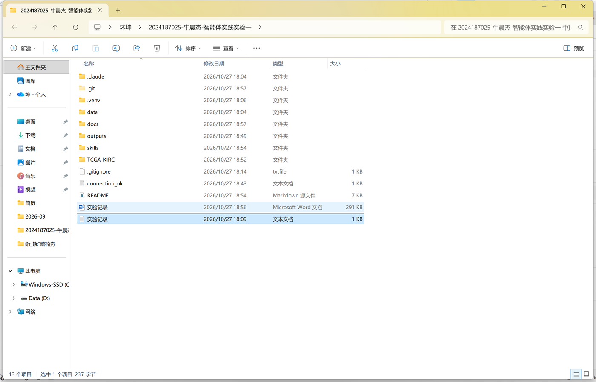
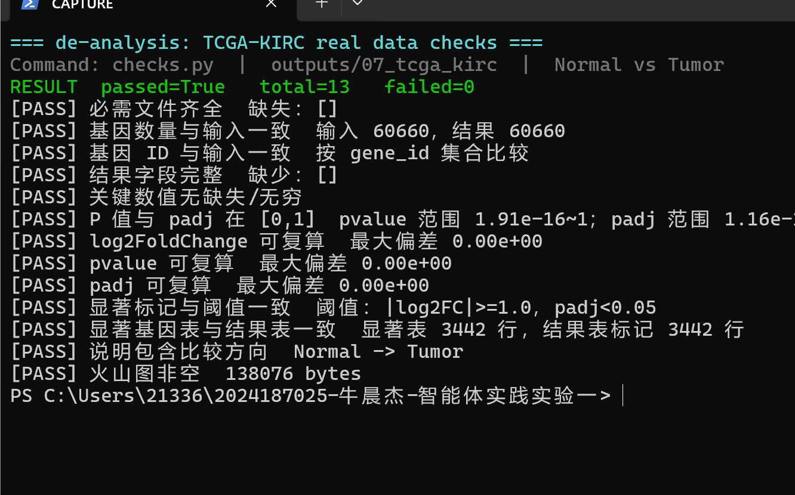
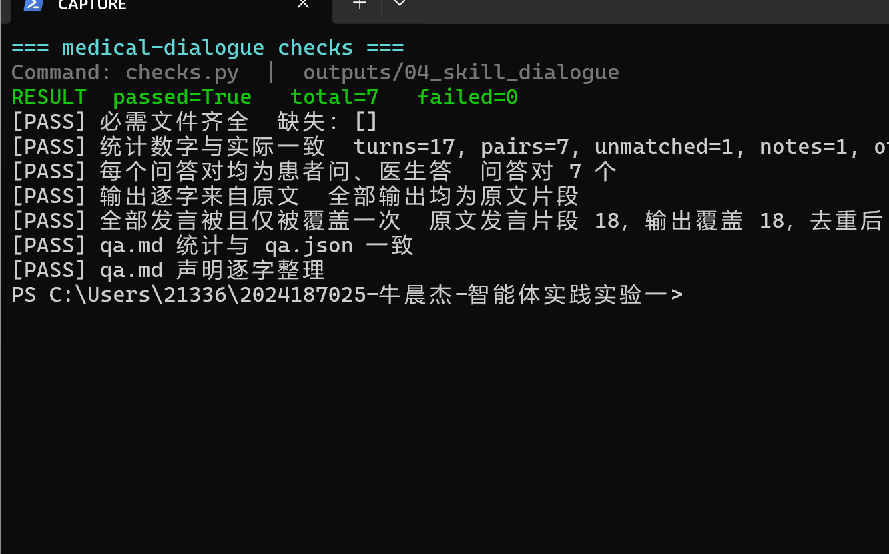

# 提交前待办（只剩人工步骤）

自动部分已完成：DeepSeek 连接记录、文件创建与回读、两个自建 Skill、TCGA-KIRC 真实
数据差异分析、现有 Skill 改造、普通提示词对照、实验记录 docx、Git 本地提交、ZIP 包。

下面 4 项必须由你本人完成。

## 1. 补拍截图（5 张必拍）

保存到 `docs/screenshots/`，文件名严格按下面写。截图前关掉 `settings.json` 标签页，
CC Switch 里点眼睛图标隐藏密钥。

| 文件名 | 拍什么 | 怎么操作 |
|---|---|---|
| `02_vscode_connected.png` | VS Code 里 Claude Code 面板回复“连接成功”，尽量带上模型状态栏 | 在 Claude Code 面板输入“请回复：连接成功” |
| `03_files_exist.png` | 资源管理器打开项目根目录，能看到 `connection_ok.txt`、`实验记录.txt`、`skills/`、`outputs/`、`TCGA-KIRC/` | 在 VS Code 左侧资源管理器展开根目录 |
| `04_file_created_read.png` | 左边编辑器是 `实验记录.txt` 初始内容，右边 Agent 显示带行号的读取结果 | 先让 Agent 读取该文件，再截图 |
| `06_webchat_compare.png` | 网页 Chat 对“在当前文件夹创建实验记录.txt 并读取”的实际回复 | 打开 DeepSeek 网页版，原样发送提示词，截它的回复 |
| `07_de_checks.png` | 终端显示 TCGA-KIRC 的 `checks.py` 输出，`"passed": true`，13 项 | 见下面命令 |
| `08_dialogue_checks.png` | 终端显示 `medical-dialogue` 的 `checks.py` 输出，`"passed": true`，7 项 | 见下面命令 |

在项目根目录打开 PowerShell：

```powershell
chcp 65001

# 7. 真实数据差异分析核验
.\.venv\Scripts\python.exe .\skills\de-analysis\scripts\checks.py `
  --output-dir .\outputs\07_tcga_kirc `
  --expression .\TCGA-KIRC\gene_counts.tsv `
  --groups .\TCGA-KIRC\groups.csv `
  --group-a Normal --group-b Tumor

# 8. 医疗对话整理核验
.\.venv\Scripts\python.exe .\skills\medical-dialogue\scripts\checks.py `
  --input .\skills\medical-dialogue\examples\sample_dialogue.txt `
  --output-dir .\outputs\04_skill_dialogue
```

建议再拍 3 张（不加分也不扣分，但更完整）：

- `09_skill_list.png`：新会话里列出 `de-analysis`、`medical-dialogue`、`skill-creator`。
- `10_github_repo.png`：推送成功后的仓库首页。
- `11_existing_skill_before_after.png`：`before_quick_validate.log`（GBK 报错）与
  `after_quick_validate.log`（`Skill is valid!`）并排。

### 把截图插进 docx

在 `docs/实验记录.md` 对应位置各加一行（路径相对 `docs/`）：

```markdown






```

建议位置：02/03 放第二节末尾，04 放 3.2，06 放 3.3，07 放 4.4.1 末尾，
08 放 5.4 末尾。然后重新生成 docx：

```powershell
.\.venv\Scripts\python.exe .\docs\build_docx.py
```

## 2. 推送 GitHub（必须）

当前仓库已配置远端 `https://github.com/mukunlife/skill.git`，但本机在 2026-10-27
连接 github.com:443 超时，推送没有完成。换到能访问 GitHub 的网络或开代理后执行：

```powershell
cd C:\Users\21336\2024187025-牛晨杰-智能体实践实验一
git remote -v
git push -u origin main
```

如果远端仓库不存在或没有权限，先在 GitHub 网页新建一个 **Public** 空仓库（不要勾选
README），再改地址：

```powershell
git remote set-url origin https://github.com/<你的用户名>/<仓库名>.git
git push -u origin main
```

推送成功后必须做这两件事：

1. 把仓库链接和 `git rev-parse HEAD` 的输出填入
   `docs/实验记录.md` 第八节和 `README.md` 的“版本”一节；
2. 重新生成 docx、提交、再推送：

```powershell
.\.venv\Scripts\python.exe .\docs\build_docx.py
git add README.md docs/实验记录.md 实验记录.docx
git commit -m "补充 GitHub 仓库链接与提交版本"
git push
```

推送前确认 `git status` 里没有 `.venv/`、`.claude/settings.json`、密钥。

## 3. 同伴复现（必须）

找一位同学，在你的仓库页面上按 `README.md` 的“复现”一节执行，然后填写
`docs/实验记录.md` 9.3 节的模板：姓名、环境、命令、`checks.py` 通过项数、遇到的问题、
与你的结果差异、签名日期。同伴只需要能访问仓库并跑通命令，不需要你的 API 密钥。

## 4. 打包与最后检查

```powershell
# 1. 确认 ZIP 已生成在上一级目录
dir ..\2024187025-牛晨杰-智能体实践实验一.zip

# 2. 重新打包（若又改了文件）
#    用 Python 脚本或右键“发送到 → 压缩文件夹”，注意排除 .venv、.git、__pycache__
```

提交前逐项确认：

- [ ] 文件夹名和 ZIP 名都是 `2024187025-牛晨杰-智能体实践实验一`
- [ ] `实验记录.docx` 能打开，截图不是“图片缺失”
- [ ] `skills/` 下两个自建 Skill 各有 `SKILL.md`、`references/`、`scripts/`、`examples/`
- [ ] `outputs/07_tcga_kirc/checks.json` 中 `"passed": true`
- [ ] `docs/screenshots/` 中至少 8 张图，且没有任何完整 API 密钥
- [ ] GitHub 仓库是 Public，链接能打开
- [ ] `docs/实验记录.md` 9.3 节已填同伴信息

## 5. 不需要再改的地方

- `skills/scientific-critical-thinking/` 和 `skills/scientific-writing/` 是未使用的
  上游候选，已从 ZIP 排除；提交整个文件夹前建议删除或移到文件夹外。
- `docs/教师要求_实验1内容.docx` 是教师原文件，仅作对照，不影响评分。
- TCGA-KIRC 真实数据已随仓库提交，同伴不需要另外下载。
